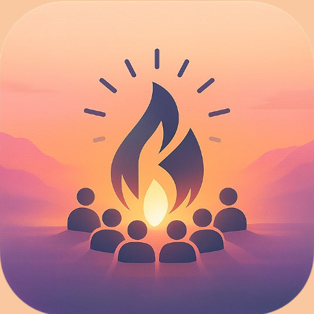
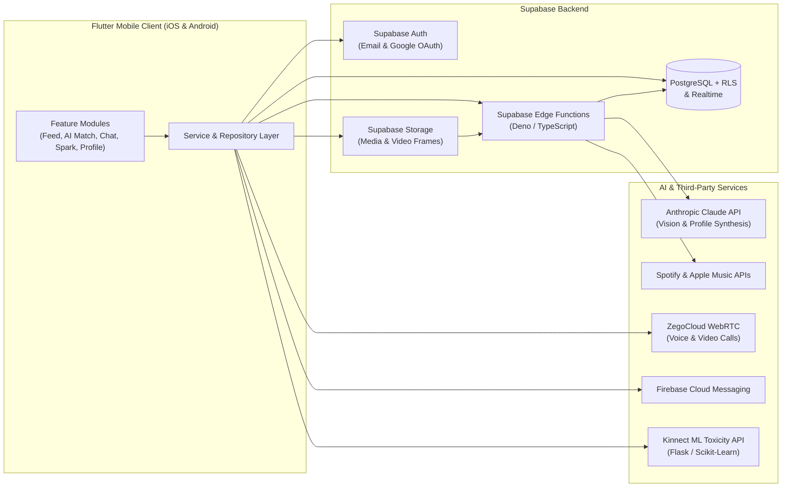
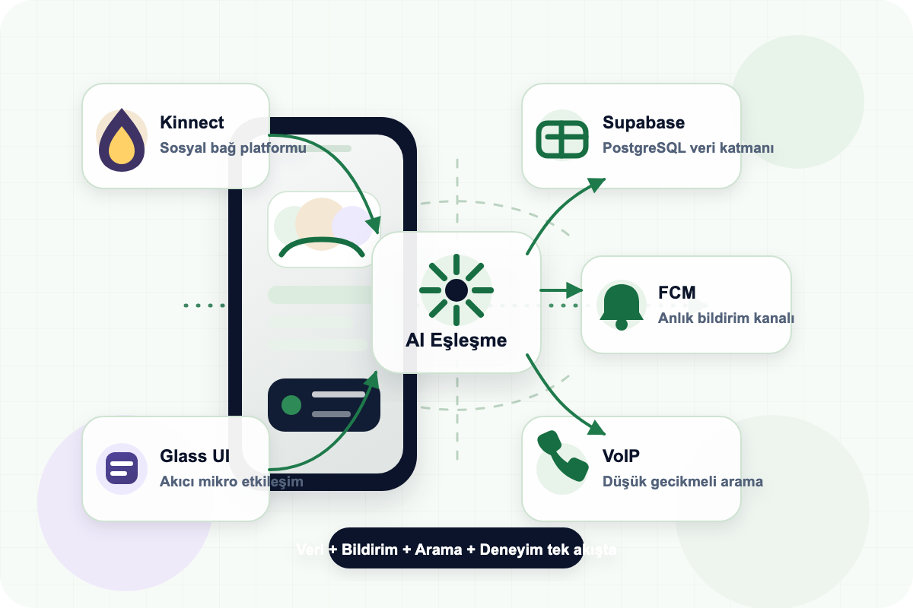
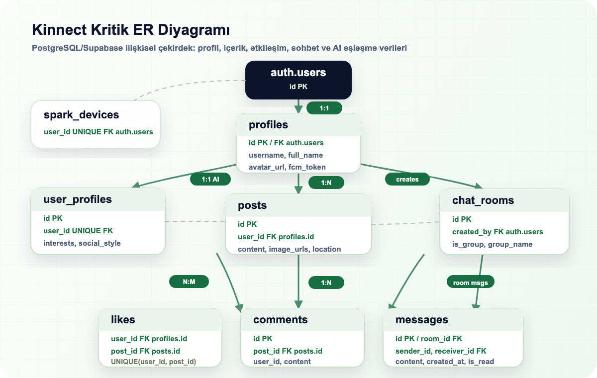

<div align="center">



# Kinnect

**AI-Powered Social Discovery & Explainable Matching Platform**

[](https://flutter.dev)
[](https://dart.dev)
[](https://supabase.com)
[](https://anthropic.com)
[](#)

*Connecting people through authentic behavioral signals, visual context, music taste, and explainable AI.*

</div>

---

## Overview

Traditional social and matching platforms rely on static, self-reported interest tags that quickly become outdated. **Kinnect** reimagines social discovery by analyzing what users actually share and experience—their photos, videos, music preferences, locations, and real-time social interactions—to build living behavioral profiles and generate **explainable, evidence-backed matches**.

Rather than showing an opaque compatibility percentage, Kinnect answers a fundamental question:

> *"Why do these two people genuinely align, and which exact moments in their feeds prove it?"*

---

## Key Features

### 1. Multimodal AI Profile Synthesis
- **Visual Scene Understanding:** Uses **Claude Vision** to inspect uploaded photos and extracted video frames, identifying environmental context, activities, and social settings (`scene_tags`).
- **Behavioral Signal Extraction:** Synthesizes post captions, locations, `@mentions`, tagged friends, and connected music libraries into a structured AI behavioral profile (`user_ai_profiles`).
- **Dynamic Social Archetypes:** Classifies social styles (e.g., *Solo*, *Paired*, *Social*, *Mixed*) and updates profiles asynchronously as users interact with the platform.

### 2. Hybrid & Explainable Matching Engine
- **Multi-Signal Weighted Scoring:** Evaluates candidate pairs across five distinct behavioral dimensions:
  | Dimension | Signal Source | Weight |
  | :--- | :--- | :---: |
  | **Interest Alignment** | Semantic & Jaccard similarity of AI-extracted interests | **30%** |
  | **Music Affinity** | Shared Spotify / Apple Music top artists, tracks, and post soundtracks | **25%** |
  | **Behavioral & Scene Context** | Visual scene tags, social style compatibility, and shared locations | **18%** |
  | **Interaction Signals** | Mutual likes, comments, and engagement patterns | **15%** |
  | **Social Graph** | Co-tags, `@mentions`, and mutual appearances in posts | **12%** |
- **Evidence-Backed Explanations (`ReasonWithSource`):** Every match reason is linked directly to the real posts from both users that triggered the connection.
- **Natural Language Match Narratives:** Powered by the `explain-match` Edge Function, generating personalized, human-friendly compatibility summaries in English and Turkish.

### 3. Rich Social & Media Experience
- **Multimodal Posts:** Share multi-photo carousels, compressed videos, Live Photos, location pins, interactive user tags, and embedded Spotify/Apple Music tracks.
- **Real-Time Communication:** 1-on-1 and group messaging with read receipts, typing/presence indicators, media sharing, and voice notes via **Supabase Realtime**.
- **Voice & Video Calling:** Low-latency audio and video calls powered by **ZegoCloud**.
- **Spark Proximity Mode:** Bluetooth Low Energy (**BLE**) proximity discovery (`flutter_blue_plus`) to detect and connect with Kinnect users nearby in real life.
- **AI Content Safety:** Integrated toxic comment detection (`ToxicityService`) backed by a custom TF-IDF + Logistic Regression ML API trained on 77,800+ comments (**90.72% accuracy**).
- **Localization & Theming:** Full **English** and **Turkish** localization (`AppL10n`) with sleek dark/light adaptive theming.

---

## System Architecture



### Architecture Diagrams

<p align="center">
  
  
</p>

---

## Project Structure

```text
kinnect/
├── lib/
│   ├── core/
│   │   ├── config/              # Environment & RTC configuration (ZegoConfig)
│   │   ├── constants/           # App constants & API key templates
│   │   ├── language/            # Bilingual localization (EN / TR)
│   │   └── theme/               # Design system, colors & theme manager
│   ├── data/
│   │   ├── models/              # Domain models
│   │   ├── repositories/        # Data access abstraction (Auth, Feed, Friend, Profile)
│   │   └── services/            # 16 core services (Matching, Chat, Spotify, BLE, Safety, etc.)
│   ├── features/
│   │   ├── ai_matching/         # AI discovery, match evidence & interactive quiz screens
│   │   ├── auth/                # Onboarding, login, signup & profile creation
│   │   ├── chat/                # 1-on-1 & group chat, voice notes, Zego voice/video calls
│   │   ├── create_post/         # Media composer, video trimmer, music & location pickers
│   │   ├── home/                # Main social feed & stories/post cards
│   │   ├── notifications/       # Real-time activity & push notification center
│   │   ├── post/                # Post details, comments & likers sheet
│   │   ├── profile/             # User profiles, music sync & AI profile insights
│   │   ├── search/              # Explore feed & user/content search
│   │   ├── settings/            # Privacy, language, theme & account settings
│   │   └── spark/               # BLE proximity discovery mode
│   ├── shared/
│   │   └── widgets/             # Reusable UI components, carousels, shimmers & overlays
│   └── main.dart                # Application entry point & background initialization
├── supabase/
│   ├── functions/
│   │   ├── analyze-user-profile/     # Multimodal post & Vision analysis via Claude
│   │   ├── match-users/              # Hybrid weighted matching & evidence extraction
│   │   ├── explain-match/            # Natural-language match explanation generator
│   │   ├── generate-post-embedding/  # Post vector embedding pipeline
│   │   ├── send-push-notification/   # FCM push notification dispatcher
│   │   └── spotify-search/           # Server-side Spotify track/artist proxy
│   └── migrations/              # PostgreSQL schema, RLS policies & triggers
└── assets/                      # Icons, Lottie animations & architecture diagrams
```

---

## Ecosystem Repositories

Kinnect is built as a modular multi-repo ecosystem:

| Repository | Description | Tech Stack |
| :--- | :--- | :--- |
| **[`kinnect`](https://github.com/emreceylantr/kinnect)** | Main iOS & Android mobile application + Supabase Edge Functions | Flutter, Supabase, Claude AI, ZegoCloud, BLE |
| **[`kinnect_admin`](https://github.com/emreceylantr/kinnect_admin)** | Desktop & Web administration dashboard for moderation, user analytics, and AI match inspection | Flutter (macOS / Web / Windows), Supabase |
| **[`kinnect-toxic-api`](https://github.com/emreceylantr/kinnect-toxic-api)** | Real-time NLP microservice for toxic comment classification | Python, Flask, Scikit-Learn (TF-IDF + Logistic Regression) |

---

## Getting Started

### Prerequisites
- **Flutter SDK** `>=3.0.0 <4.0.0`
- **Xcode** (for iOS builds) / **Android Studio** (for Android builds)
- **Supabase CLI** (optional, for deploying Edge Functions)

### 1. Clone & Install Dependencies

```bash
git clone https://github.com/emreceylantr/kinnect.git
cd kinnect
flutter pub get
```

For iOS, install CocoaPods dependencies:

```bash
cd ios && pod install && cd ..
```

### 2. Configure API Keys & Environment

Copy the example configuration files and populate your credentials:

```bash
cp lib/core/constants/api_keys.example.dart lib/core/constants/api_keys.dart
cp lib/core/config/zego_config.example.dart lib/core/config/zego_config.dart
```

Configure the following secrets in your **Supabase Dashboard -> Edge Functions -> Secrets**:
- `ANTHROPIC_API_KEY` — Anthropic Claude API key for profile synthesis and match explanations
- `SUPABASE_URL` & `SUPABASE_SERVICE_ROLE_KEY` — Automatically provided by Supabase runtime
- `SPOTIFY_CLIENT_ID` & `SPOTIFY_CLIENT_SECRET` — For server-side music search

### 3. Run the Application

```bash
flutter run \
  --dart-define=ZEGO_APP_ID=YOUR_ZEGO_APP_ID \
  --dart-define=ZEGO_APP_SIGN=YOUR_ZEGO_APP_SIGN
```

To build a release iOS archive (`.ipa`):

```bash
flutter build ipa --release
```

---

## Security & Privacy

- **Row-Level Security (RLS):** All PostgreSQL tables enforce strict `auth.uid()` policies.
- **Zero Client-Side AI Keys:** All LLM and Vision operations execute inside isolated Supabase Edge Functions; `ANTHROPIC_API_KEY` never leaves the server.
- **Secret Hygiene:** Local credential files (`api_keys.dart`, `zego_config.dart`, `.env`) are git-ignored and parameterized via `--dart-define`.

---

## License

Developed as a Capstone Engineering Project. All rights reserved.
