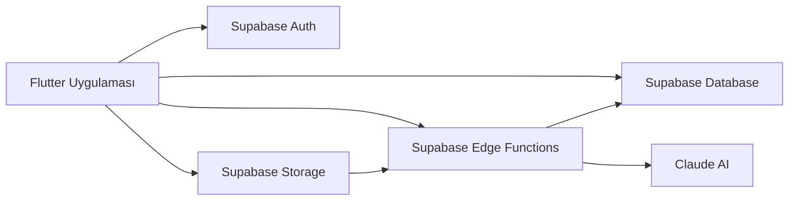
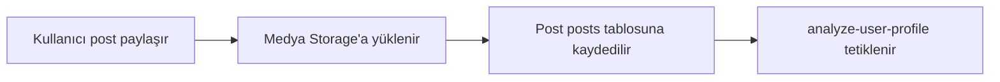

# Kinnect

Kinnect, yapay zeka destekli bir sosyal medya ve eşleşme uygulamasıdır. Uygulama; kullanıcıların paylaşımlarını, fotoğraf/video içeriklerini, müzik tercihlerini, konumlarını ve sosyal etkileşimlerini analiz ederek daha anlamlı sosyal bağlantılar kurmayı hedefler.

Klasik sosyal medya uygulamalarından farklı olarak Kinnect yalnızca kullanıcıların manuel olarak seçtiği ilgi alanlarına bakmaz. Kullanıcının gerçek paylaşımlarından ve davranışlarından bir profil çıkarır, bu profili yapay zeka ile yorumlar ve diğer kullanıcılarla açıklanabilir eşleşmeler üretir.

## Projenin Amacı

Kinnect'in temel amacı, kullanıcıların sosyal medya üzerindeki içeriklerinden yola çıkarak daha doğal ve anlamlı bağlantılar kurmasını sağlamaktır.

Uygulama şu soruya cevap arar:

> "Bu iki kullanıcı gerçekten hangi yönlerden benziyor ve neden tanışmaları mantıklı?"

Bu yüzden sistem sadece ortak ilgi alanlarına değil; fotoğraf ortamlarına, müzik zevklerine, konumlara, post etkileşimlerine, sosyal stile ve kullanıcı davranışlarına da bakar.

## Temel Özellikler

- E-posta ve Google ile kullanıcı girişi
- Profil oluşturma ve profil düzenleme
- Fotoğraf, video, metin, müzik ve konum içeren post paylaşımı
- Fotoğraf düzenleme ve fotoğraf üzerinde kullanıcı etiketleme
- Beğeni, yorum, bildirim ve arkadaşlık sistemi
- Birebir ve grup mesajlaşma
- Sesli ve görüntülü arama
- Spotify ve Apple Music entegrasyonu
- Yapay zeka destekli kullanıcı profili analizi
- Yapay zeka destekli eşleşme sistemi
- Eşleşme sebeplerini gerçek postlarla açıklama
- Yakındaki kullanıcıları keşfetmeye yönelik Spark modu
- Türkçe ve İngilizce dil desteği
- Karanlık ve açık tema desteği

## Kullanılan Teknolojiler

### Mobil Uygulama

- Flutter
- Dart
- Material Design
- Shared Preferences
- Google Fonts
- Lottie animasyonları

### Backend ve Veri Katmanı

- Supabase Auth
- Supabase Database
- Supabase Storage
- Supabase Edge Functions
- Supabase Realtime
- Row Level Security politikaları

### Yapay Zeka

- Anthropic Claude
- Claude Vision ile fotoğraf/video karesi analizi
- Claude ile kullanıcı profili sentezleme
- Claude ile eşleşme açıklaması üretme

### Medya ve İletişim

- Firebase Cloud Messaging ile push bildirimleri
- ZegoCloud ile sesli/görüntülü arama
- Spotify API
- Apple Music entegrasyonu
- Video sıkıştırma ve video kare çıkarma

## Uygulama Mimarisi

Kinnect genel olarak üç ana katmandan oluşur:

1. **Flutter istemci uygulaması**
   Kullanıcı arayüzü, post oluşturma, profil ekranları, mesajlaşma, eşleşme ekranı ve uygulama içi deneyim bu katmandadır.

2. **Supabase backend**
   Kimlik doğrulama, veritabanı, dosya depolama, realtime veriler ve Edge Function'lar Supabase üzerinde çalışır.

3. **Yapay zeka servisleri**
   Fotoğraf/video analizi, profil çıkarımı ve eşleşme açıklaması Claude tabanlı Edge Function'lar üzerinden yapılır.



## Yapay Zeka Eşleşme Sistemi

Kinnect'in en önemli kısmı yapay zeka destekli eşleşme sistemidir. Bu sistem kullanıcıların paylaşımlarını analiz ederek her kullanıcı için bir "AI profil" oluşturur.

### 1. Post Oluşturma

Kullanıcı yeni bir post paylaştığında fotoğraflar ve videolar Supabase Storage'a yüklenir. Postun metni, müzik bilgisi, konumu ve medya URL'leri `posts` tablosuna kaydedilir.

Video paylaşımı varsa sistem videonun tamamını yapay zekaya göndermek yerine videodan birkaç kare çıkarır. Bu kareler Storage'a yüklenir ve `video_frame_urls` alanında saklanır.

### 2. Analizin Tetiklenmesi

Post kaydedildikten sonra uygulama arka planda `analyze-user-profile` adlı Supabase Edge Function'ı çağırır. Bu işlem kullanıcıyı bekletmeden yapılır.



### 3. Claude ile Fotoğraf ve Video Analizi

`analyze-user-profile` fonksiyonu kullanıcının son postlarını çeker. Her post için şu veriler değerlendirilir:

- Fotoğraf URL'leri
- Video kare URL'leri
- Post açıklaması
- Konum bilgisi
- Spotify/Apple Music bilgileri
- Kullanıcı etiketleri

Eğer postta fotoğraf varsa Claude'a görsel olarak gönderilir. Eğer postta video varsa videodan çıkarılan kareler Claude'a gönderilir.

Claude'dan her post için JSON formatında analiz istenir:

```json
{
  "analysis": "Fotoğrafta iki kişi kafe ortamında vakit geçiriyor. Ortam samimi ve sosyal bir buluşma havasında.",
  "scene_tags": ["kafe", "kahve", "arkadaşlar", "sosyal", "akşam"]
}
```

Bu analiz sonucunda sistem postun ortamını, aktivitesini, sosyal bağlamını ve atmosferini anlamaya çalışır.

### 4. Analizlerin Veritabanına Kaydedilmesi

Her post için çıkarılan analizler tekrar veritabanına yazılır:

- `photo_scene_tags`: Fotoğraf/video ortamından çıkarılan etiketler
- `mentioned_usernames`: Post metnindeki kullanıcı mention'ları

Örneğin:

```text
photo_scene_tags = ["kafe", "kahve", "arkadaşlar", "sosyal"]
mentioned_usernames = ["emre", "batuhan"]
```

Bu veriler daha sonra eşleşme skorunda kullanılır.

### 5. Kullanıcı Profilinin Sentezlenmesi

Tek tek post analizleri tamamlandıktan sonra Claude bu analizleri topluca değerlendirir ve kullanıcı için genel bir profil üretir.

Üretilen profil şu bilgileri içerir:

- Türkçe profil özeti
- İngilizce profil özeti
- İlgi alanları listesi
- Sosyal stil

Sosyal stil şu kategorilerden biridir:

- `yalnız`: Kullanıcı genellikle tek başına içerik paylaşıyor
- `ikili`: Kullanıcı genellikle bir kişiyle içerik paylaşıyor
- `sosyal`: Kullanıcı genellikle kalabalık/grup ortamlarında bulunuyor
- `karma`: Kullanıcı hem sosyal hem bireysel ortamlarda aktif

Bu sonuçlar `user_profiles` tablosuna kaydedilir.

## Veritabanında AI Profil Yapısı

AI analizinden sonra oluşan kullanıcı profili `user_profiles` tablosunda tutulur.

Temel alanlar:

- `user_id`
- `profile_summary`
- `interests`
- `social_style`
- `analyzed_post_count`
- `quiz_answers`
- `spotify_top_artists`
- `spotify_top_tracks`
- `updated_at`

Bu yapı sayesinde kullanıcı her yeni post attığında profili güncellenebilir.

## Eşleşme Skoru Nasıl Hesaplanır?

Eşleşme sistemi `match-users` Edge Function'ı içinde çalışır. Sistem mevcut kullanıcının AI profilini ve diğer kullanıcıların AI profillerini karşılaştırır.

Skor beş ana kategori üzerinden hesaplanır:

| Kategori | Açıklama | Ağırlık |
| --- | --- | --- |
| İlgi alanı skoru | Claude tarafından çıkarılan ilgi alanlarının benzerliği | %30 |
| Müzik skoru | Ortak sanatçı, şarkı ve müzik zevki | %25 |
| Davranış/ortam skoru | Fotoğraf sahne etiketleri, sosyal stil ve konum benzerliği | %18 |
| Sosyal grafik skoru | Mention, etiketleme ve birbirinin postlarında görünme | %12 |
| Etkileşim skoru | Beğeni ve yorum davranışları | %15 |

Bu skorlar birleştirilir, normalize edilir ve en yüksek uyuma sahip kullanıcılar listelenir.

## Açıklanabilir Eşleşme Mantığı

Kinnect sadece "bu kullanıcıyla %80 uyumlusun" demez. Aynı zamanda bu eşleşmenin neden oluştuğunu da açıklar.

Örnek eşleşme sebepleri:

- "İkiniz de aynı sanatçıyı dinliyorsunuz."
- "Benzer kafe ortamlarında paylaşım yapıyorsunuz."
- "Birbirinizin paylaşımlarına yorum yapıyorsunuz."
- "İkiniz de seyahat ve müzikle ilgileniyorsunuz."
- "Aynı konumdan paylaşım yapmışsınız."

Bu sebeplerin yanında gerçek postlar da gösterilir. Böylece kullanıcı eşleşmenin sadece soyut bir skor olmadığını, gerçek davranışlara dayandığını görebilir.

## Claude ile Eşleşme Açıklaması

Eşleşme detay ekranında `explain-match` Edge Function'ı çalışır. Bu fonksiyon iki kullanıcının:

- AI profil özetlerini
- İlgi alanlarını
- Son postlarını
- Ortak eşleşme sebeplerini

Claude'a gönderir. Claude da teknik olmayan, doğal ve kısa bir açıklama üretir.

Örnek:

> "Sen de canlı müzik ve kafe ortamlarını seviyorsun, Ayşe'nin paylaşımlarında da aynı enerjiyi görmek mümkün. İkinizin de sosyal ve müzik odaklı bir tarzı olduğu için tanışmanız oldukça doğal görünüyor."

## Güvenlik ve Gizlilik

- Kullanıcı oturumları Supabase Auth ile yönetilir.
- Veritabanında Row Level Security politikaları kullanılır.
- Kullanıcı bazlı işlemler `auth.uid()` kontrolüyle sınırlandırılır.
- Edge Function'lar hassas işlemler için Supabase service role key ile backend tarafında çalışır.
- API anahtarları kod içinde tutulmaz; Supabase secrets/environment değişkenleri üzerinden yönetilir.

## Proje Klasör Yapısı

```text
lib/
  core/
    config/
    language/
    theme/
  data/
    repositories/
    services/
  features/
    ai_matching/
    auth/
    chat/
    create_post/
    home/
    notifications/
    post/
    profile/
    search/
    settings/
    spark/
  shared/

supabase/
  functions/
    analyze-user-profile/
    match-users/
    explain-match/
    send-push-notification/
    spotify-search/
  migrations/
```

## Önemli Edge Function'lar

- `analyze-user-profile`: Kullanıcının postlarını analiz eder, Claude ile AI profil üretir.
- `match-users`: Kullanıcıları AI profil, müzik, sahne, etkileşim ve sosyal sinyallerle eşleştirir.
- `explain-match`: Eşleşmenin nedenini Claude ile doğal dille açıklar.
- `send-push-notification`: Push bildirim gönderir.
- `spotify-search`: Spotify arama işlemlerini yönetir.

## Kurulum

Flutter bağımlılıklarını yüklemek için:

```bash
flutter pub get
```

iOS bağımlılıkları için:

```bash
cd ios
pod install
cd ..
```

Uygulamayı çalıştırmak için:

```bash
flutter run
```

IPA üretmek için:

```bash
flutter build ipa --release
```

## Gerekli Servis Ayarları

Projeyi sıfırdan çalıştırmak için aşağıdaki servislerin yapılandırılması gerekir:

- Supabase proje URL'i ve anon key
- Supabase Edge Function secrets
- `ANTHROPIC_API_KEY`
- Firebase yapılandırması
- Google Sign-In client bilgileri
- Spotify client bilgileri
- ZegoCloud AppID ve AppSign

ZegoCloud bilgileri build sırasında `dart-define` ile de verilebilir:

```bash
flutter run \
  --dart-define=ZEGO_APP_ID=APP_ID \
  --dart-define=ZEGO_APP_SIGN=APP_SIGN
```

## Bitirme Projesi Açısından Öne Çıkan Noktalar

- Gerçek sosyal medya verilerinden AI profil çıkarımı
- Claude Vision ile fotoğraf/video sahne analizi
- Sosyal medya davranışlarına göre açıklanabilir eşleşme
- Supabase Edge Function tabanlı backend mimarisi
- Gerçek zamanlı mesajlaşma ve bildirim altyapısı
- Müzik zevki, konum, etkileşim ve görsel bağlamı birlikte değerlendiren hibrit skor sistemi

## Geliştiriciler

Bu proje bitirme projesi kapsamında geliştirilmiştir.

Kinnect, sosyal medya deneyimini yapay zeka ile daha kişisel, açıklanabilir ve bağlantı odaklı hale getirmeyi amaçlar.
